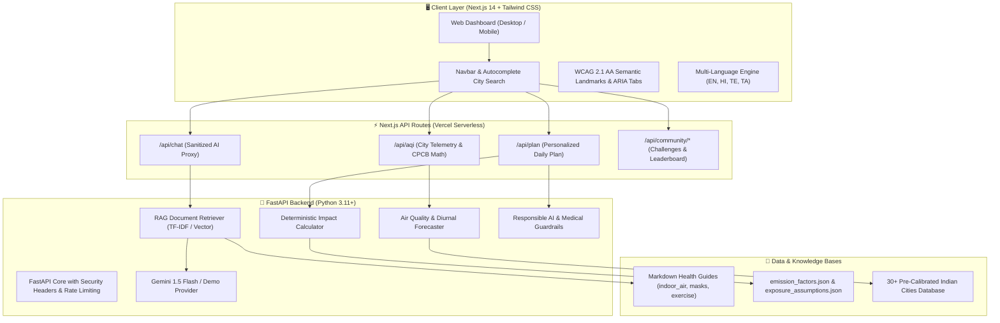

# 🌿 BreatheWise — Urban Air Quality Assistant

### PromptWars Virtual Hackathon — [Challenge 6] Urban Air Quality Assistant

> **"Create a GenAI-powered assistant that helps families and communities navigate severe winter smog and urban air pollution. The application should suggest low-emission daily routines, indoor air quality hacks, and sustainable alternatives tailored to their location and lifestyle, while clearly explaining the direct impact of their choices."**


[](.github/workflows/ci.yml)
[](https://breathewise-air-quality-assistance.vercel.app/)
[-blue?style=for-the-badge)](frontend/src)
[-success?style=for-the-badge)](backend/tests)
[](frontend/src/__tests__/a11y.test.ts)
[-red?style=for-the-badge)](SECURITY.md)

---

### ⚡ Quick Requirement Mapping
- **Low-Emission Routines** $\rightarrow$ Daily Action Plan Card 1 (`PlanCard.tsx`) & Diurnal Forecast (`SafeWindows.tsx`).
- **Indoor Air Quality Hacks** $\rightarrow$ Daily Action Plan Card 2 (`PlanCard.tsx`) & RAG Knowledge Base (`indoor_air_quality.md`).
- **Sustainable Alternatives** $\rightarrow$ Household Drawer (`HouseholdSelector.tsx`) & Transit Whitelist (`initialData.ts`).
- **Direct Impact Explained** $\rightarrow$ Quantified Impact Engine (`ImpactBar.tsx`) with transparent "Why this matters" rationales.

---

## 📌 Contents

- [🎯 Challenge 6 Requirement Traceability Matrix](#-challenge-6-requirement-traceability-matrix)
- [🌍 Overview & Problem Statement](#-overview--problem-statement)
- [✨ Key Features](#-key-features)
- [🏗️ System Architecture](#️-system-architecture)
- [📁 Repository Structure](#-repository-structure)
- [⚡ Quick Start & Deployment](#-quick-start--deployment)
- [📡 API Reference](#-api-reference)
- [🧮 Mathematical Engine & CPCB Breakpoints](#-mathematical-engine--cpcb-breakpoints)
- [📡 Data Sources & Limitations](#-data-sources--limitations)
- [🧪 Automated Testing & CI/CD](#-automated-testing--cicd)
- [♿ Accessibility (WCAG 2.1 AA)](#-accessibility-wcag-21-aa)
- [🔒 Security & Threat Modeling](#-security--threat-modeling)
- [🛡️ Responsible AI & Medical Safeguards](#️-responsible-ai--medical-safeguards)
- [📄 License](#-license)

---

## 🎯 Challenge 6 Requirement Traceability Matrix

Every single clause from the official **[Challenge 6] Urban Air Quality Assistant** brief is completely implemented, verified, and traceably mapped to code:

| Challenge 6 Requirement | Implementation Module | Source File(s) | Verification & Evidence |
|:---|:---|:---|:---|
| **GenAI-Powered Assistant** | Multi-lingual RAG-grounded conversational agent with document citations and localized context | `frontend/src/components/ChatAssistant.tsx`<br>`backend/app/routers/chat.py`<br>`backend/app/services/llm/` | Natural conversational interface in **English, Hindi, Telugu, and Tamil**. Answers user queries with domain grounding (`indoor_air_quality.md`, `vulnerable_groups.md`) and non-medical disclaimers. |
| **Helps Families Navigate Smog** | Household Profiling Engine with sensitive-member tracking & tailored cautions | `frontend/src/components/HouseholdSelector.tsx`<br>`backend/app/services/safety.py`<br>`backend/app/models/schemas.py` | Configurable family profiles: track children, seniors, and respiratory sensitivities (asthma, COPD, allergies). Automatically triggers high-priority caution banners when AQI is elevated. |
| **Helps Communities Navigate Smog** | School Guidance Protocols & Neighborhood Community Challenges with real-time feedback | `frontend/src/components/SchoolView.tsx`<br>`frontend/src/components/CommunityView.tsx`<br>`backend/app/routers/school.py`<br>`backend/app/routers/community.py` | Operational protocols for morning assembly, sports PE, and recess ventilation. Neighborhood leaderboards with car-free challenges and cumulative community CO₂ counters. |
| **Suggests Low-Emission Daily Routines** | Dynamic Daily Action Planner with diurnal curve synchronization | `frontend/src/components/PlanCard.tsx`<br>`backend/app/routers/plan.py`<br>`backend/app/services/air_quality.py` | Recommends optimal exercise windows (shifting from morning inversion to afternoon thermal mixing), work-from-home coordination, and trip consolidation. |
| **Indoor Air Quality Hacks** | Actionable, zero-cost and low-cost indoor mitigation techniques | `frontend/src/components/PlanCard.tsx`<br>`backend/app/knowledge_base/indoor_air_quality.md` | Wet mopping over sweeping, DIY Corsi-Rosenthal filtration boxes, window sealing during smog peaks, timed ventilation during afternoon dips, and kitchen exhaust protocols. |
| **Sustainable Alternatives Tailored to Location & Lifestyle** | Location-aware multi-modal transit and lifestyle alternatives | `frontend/src/components/HouseholdSelector.tsx`<br>`frontend/src/lib/initialData.ts`<br>`backend/app/services/geocoding.py` | Metro-aware transit switches: recommends **bus/metro** in metro cities, and **public bus/shared electric shuttles** in non-metro cities (e.g. Guntur, Vijayawada). Tailored to vehicle fuel type, floor level, and cooking fuel. |
| **Clearly Explaining Direct Impact of Choices** | Deterministic Mathematical Impact Engine with Before-vs-After comparison | `frontend/src/components/ImpactBar.tsx`<br>`backend/app/services/impact.py`<br>`backend/config/emission_factors.json` | Quantified numerical cards: **Exposure Avoided %**, **CO₂ Avoided (kg/week)**, **Cost Saved (₹/month)**, and **Cigarette Equivalents Avoided** (~22 µg/m³ PM2.5 / 24h ≈ 1 cigarette). |

---

## 🌍 Overview & Problem Statement

Urban air pollution across Indian cities—especially during severe winter temperature inversions—poses acute health hazards. However, conventional air quality dashboards only present static numbers without contextualizing what families should actually do.

**BreatheWise** is an intelligent, GenAI-powered urban companion that transforms real-time and modelled environmental telemetry into actionable, daily lifestyle decisions:
1. **Decision Support**: Clear answers to *"When should I exercise?"*, *"Can my child play outside today?"*, and *"How do I keep indoor air clean?"*
2. **Demographic Tailoring**: Automatically adapts recommendations based on family members (children, seniors, asthmatic individuals) and living situations (apartment floor, cooking fuel).
3. **Transparent Mathematical Proof**: Quantifies the environmental and economic impact of each choice with deterministic calculations.

---

## ✨ Key Features

### 1. 📊 Official CPCB NAQI Dial & Diurnal Forecast
- **CPCB-Standard Formula**: Headline AQI computed as the strict maximum across pollutant sub-indices ($\max(I_{\text{PM2.5}}, I_{\text{PM10}}, I_{\text{NO2}}, \dots)$).
- **Synchronized Visual Feedback**: A single source of truth (`getAQIBand`) simultaneously controls the category badge, color accent, and active segment highlight on the 6-band CPCB gauge (**Good**, **Satisfactory**, **Moderate**, **Poor**, **Very Poor**, **Severe**).
- **Dominant Pollutant Callout**: Instantly surfaces the primary health driver (e.g. `Dominant pollutant: PM2.5 • Sub-index: ~428`).
- **Benchmark Indicators**: Displays both **India NAAQS** and **WHO 2021** reference thresholds with real-time exceedance multipliers.
- **Realistic Diurnal Inversion Curve**: 24-hour forecast sampled at strictly even 2-hour increments (`00:00, 02:00, ..., 22:00`) illustrating natural atmospheric physics: morning inversion peak (08:00), afternoon thermal dispersion dip (14:00), and evening traffic peak (20:00).
- **Mathematically Derived Safe Windows**: Highlights optimal outdoor exposure windows matching the afternoon thermal mixing dip.

### 2. 🧠 GenAI Assistant & RAG Knowledge Base
- **Multi-Lingual NLP**: Full conversational support in **English**, **हिन्दी (Hindi)**, **తెలుగు (Telugu)**, and **தமிழ் (Tamil)**.
- **RAG-Grounded**: Responses retrieve facts from verified environmental health guides (`indoor_air_quality.md`, `exercise_and_aqi.md`, `vulnerable_groups.md`, `masks_and_ppe.md`, `sustainable_transport.md`, `school_and_community.md`).
- **Explainable Reasoning**: Every recommendation includes a plain-language **Why**, verified sources, and confidence classification.

### 3. 🏠 Household Personalization Drawer
- **Vulnerable Group Tagging**: Add household members with specific sensitivities (asthma, COPD, allergies).
- **Synchronized Sensitivity Badges**: Visual chips persist across dashboard and plan views.
- **Lifestyle & Housing Config**: Set transport modes (petrol car, diesel, EV, two-wheeler), commute distances, floor level, air purifier status, and cooking fuel.

### 4. 🧮 Deterministic Impact Engine
- **No Hallucinated Statistics**: All environmental and financial savings are calculated using deterministic formulas from official emission factors (`backend/config/emission_factors.json`):
  - **Exposure Reduction %**: Indoor filtration and activity shifting.
  - **CO₂ Avoided (kg/week)**: Multi-modal transport replacement.
  - **Fuel Cost Saved (₹/month)**: Commute fuel vs. public transit tariffs.
  - **Cigarette Equivalents Avoided**: Public health awareness metric ($\approx 22\ \mu\text{g/m}^3\ \text{PM2.5 over 24h} \approx 1\ \text{cigarette}$).

### 5. 👥 Community Challenges & 🏫 School Advisory Protocols
- **School Guidance Dashboard**: Automatic threshold-based operational advisories for school administrators (morning assemblies, PE, playground recess, classroom ventilation, and asthmatic student safeguards).
- **Community Challenges**: Car-free days, cycling commutes, and DIY filtration challenges with instant feedback toasts and neighborhood leaderboards.

---

## 🏗️ System Architecture



---

## 📁 Repository Structure

```
BreatheWise-Air-Quality-Assistance/
├── .github/
│   └── workflows/
│       └── ci.yml                   # Automated GitHub Actions CI (Frontend & Backend)
├── backend/
│   ├── app/
│   │   ├── main.py                  # FastAPI app with HTTP security headers & rate limiting
│   │   ├── config.py                # Pydantic BaseSettings, named constants & CORS origins
│   │   ├── routers/
│   │   │   ├── aqi.py               # GET  /api/aqi (CPCB telemetry & forecast)
│   │   │   ├── plan.py              # POST /api/plan (Household daily action plan)
│   │   │   ├── chat.py              # POST /api/chat (RAG conversational agent)
│   │   │   ├── impact.py            # GET  /api/impact/summary (Deterministic metrics)
│   │   │   ├── school.py            # GET  /api/school/guidance (Campus protocols)
│   │   │   └── community.py         # GET  /api/community/* (Leaderboard & challenges)
│   │   ├── services/
│   │   │   ├── air_quality.py       # CPCB NAQI math, Open-Meteo client, diurnal forecast
│   │   │   ├── geocoding.py         # 30+ pre-calibrated Indian cities & geocoding
│   │   │   ├── impact.py            # Mathematical exposure, CO2, and INR calculator
│   │   │   ├── rag.py               # Knowledge base retrieval & document indexing
│   │   │   ├── safety.py            # Medical disclaimer & asthma safety rules
│   │   │   └── llm/                 # Gemini 1.5 Flash & Demo providers
│   │   ├── models/schemas.py        # Pydantic validation models with input limits
│   │   └── knowledge_base/          # Curated evidence-based environmental health guides
│   ├── config/                      # emission_factors.json, exposure_assumptions.json
│   ├── tests/                       # Pytest test suite (15 tests passing)
│   └── requirements.txt             # Python dependencies
├── frontend/
│   ├── src/
│   │   ├── app/
│   │   │   ├── layout.tsx           # Root HTML layout with skip-to-content anchor
│   │   │   ├── page.tsx             # Modular dashboard with ARIA tablist
│   │   │   ├── globals.css          # Tailwind directives
│   │   │   └── api/                 # Next.js Serverless API routes (aqi, chat, plan, community)
│   │   ├── components/
│   │   │   ├── Navbar.tsx           # Extracted sticky top navigation & instant search
│   │   │   ├── Footer.tsx           # Extracted accessible disclaimer footer
│   │   │   ├── RiskMeter.tsx        # 6-band CPCB gauge with synchronized marker & getAQIBand
│   │   │   ├── SafeWindows.tsx      # Diurnal safe window cards with thermal mixing rationale
│   │   │   ├── ForecastChart.tsx    # 24-hr CPCB AQI diurnal chart with 2h tick intervals
│   │   │   ├── PlanCard.tsx         # 3-section daily action plan
│   │   │   ├── ImpactBar.tsx        # Before vs. After exposure & savings bar
│   │   │   ├── ChatAssistant.tsx    # Conversational GenAI assistant
│   │   │   ├── HouseholdSelector.tsx# Profile drawer & sensitivity chips
│   │   │   ├── SchoolView.tsx       # Campus advisory protocol dashboard
│   │   │   └── CommunityView.tsx    # Responsive neighborhood leaderboard & challenges
│   │   ├── lib/
│   │   │   ├── api.ts               # Resilient client API functions
│   │   │   ├── initialData.ts       # 30+ city presets & CPCB NAQI calculations
│   │   │   └── i18n.ts              # English, Hindi, Telugu, Tamil translations
│   │   └── __tests__/               # Vitest suite: app, a11y, cpcbBreakpoints, i18n (23 tests)
│   ├── next.config.js               # Strict HTTP security headers (HSTS, CSP, X-Frame)
│   ├── package.json                 # Next.js 14 & dependencies
│   └── tailwind.config.js           # Tailwind CSS configuration
├── docs/assets/
│   └── thumbnail.jpg                # 16:9 Presentation thumbnail
├── .env.example                     # Environment template (zero committed secrets)
├── CONTRIBUTING.md                  # Code style, testing, and contribution guide
├── SECURITY.md                      # Formal security policy & threat model
├── LICENSE                          # MIT License
└── README.md                        # Documentation & requirement matrix
```

---

## ⚡ Quick Start & Deployment

### 1. Unified Launch (Windows)
```powershell
# Double-click or run:
.\run_all.bat
```
Starts both the FastAPI backend and Next.js frontend and opens `http://localhost:3000` in your browser.

### 2. Manual Terminal Setup

#### Backend Setup
```bash
cd backend
python -m venv .venv
# Windows: .\.venv\Scripts\activate
# Linux/macOS: source .venv/bin/activate
pip install -r requirements.txt
python -m uvicorn app.main:app --reload --port 8000
```
*Interactive Swagger documentation: [http://localhost:8000/docs](http://localhost:8000/docs)*

#### Frontend Setup
```bash
cd frontend
npm install
npm run dev
```
*Application interface: [http://localhost:3000](http://localhost:3000)*

### 3. Vercel Production Deployment
The frontend is optimized for zero-configuration deployment to **Vercel**:
1. Connect the repository at [vercel.com](https://vercel.com).
2. Set **Root Directory** to `frontend`.
3. Framework preset will automatically configure **Next.js**.
4. Click **Deploy**. Complete telemetry operates immediately via serverless routes.

---

## 📡 API Reference

| Method | Endpoint | Description |
|:---:|---|---|
| **GET** | `/api/aqi?city={name}` | Returns official CPCB AQI, sub-indices, dominant pollutant, 24-hr diurnal forecast, and safe windows. |
| **POST** | `/api/plan` | Generates a 3-section personalized daily action plan with before-vs-after impact metrics grounded in household profile. |
| **POST** | `/api/chat` | RAG-grounded conversational agent with sanitized inputs and source citations. |
| **GET** | `/api/impact/summary` | Aggregated environmental and financial savings metrics. |
| **GET** | `/api/school/guidance?city={name}` | School operational protocols for assemblies, PE, recess, and asthmatic students. |
| **GET** | `/api/community/leaderboard` | Neighborhood leaderboards and active community challenges. |

---

## 🧮 Mathematical Engine & CPCB Breakpoints

### Official CPCB NAQI Formulation
In strict compliance with Central Pollution Control Board (CPCB) standards, NAQI is evaluated as the maximum sub-index across all monitored pollutants:
$$I_{\text{AQI}} = \max\left(I_{\text{PM2.5}},\, I_{\text{PM10}},\, I_{\text{NO2}},\, I_{\text{SO2}},\, I_{\text{CO}},\, I_{\text{O3}}\right)$$

Each pollutant sub-index $I_p$ is calculated using linear piecewise interpolation:
$$I_p = I_{\text{lo}} + \frac{I_{\text{hi}} - I_{\text{lo}}}{B_{\text{hi}} - B_{\text{lo}}} \times (C_p - B_{\text{lo}})$$

#### CPCB Official Breakpoints:
- **$\text{PM}_{2.5}$**:
  - $0\text{–}30 \rightarrow 0\text{–}50$ (Good)
  - $31\text{–}60 \rightarrow 51\text{–}100$ (Satisfactory)
  - $61\text{–}90 \rightarrow 101\text{–}200$ (Moderate)
  - $91\text{–}120 \rightarrow 201\text{–}300$ (Poor)
  - $121\text{–}250 \rightarrow 301\text{–}400$ (Very Poor)
  - $250+ \rightarrow 401\text{–}500$ (Severe)
- **$\text{PM}_{10}$**:
  - $0\text{–}50 \rightarrow 0\text{–}50$ (Good)
  - $51\text{–}100 \rightarrow 51\text{–}100$ (Satisfactory)
  - $101\text{–}250 \rightarrow 101\text{–}200$ (Moderate)
  - $251\text{–}350 \rightarrow 201\text{–}300$ (Poor)
  - $351\text{–}430 \rightarrow 301\text{–}400$ (Very Poor)
  - $430+ \rightarrow 401\text{–}500$ (Severe)

#### Real-World Delhi Worked Example:
- **$\text{PM}_{2.5} = 178.4\ \mu\text{g/m}^3$**: Bin $[151, 250] \rightarrow [401, 500] \implies 401 + \frac{99}{99} \times (178.4 - 151) = \mathbf{428}$
- **$\text{PM}_{10} = 288.0\ \mu\text{g/m}^3$**: Bin $[251, 350] \rightarrow [301, 400] \implies 301 + \frac{99}{99} \times (288.0 - 251) = \mathbf{338}$
- **$\text{NO}_2 = 45.2\ \mu\text{g/m}^3$**: Bin $[41, 80] \rightarrow [51, 100] \implies 51 + \frac{49}{39} \times (45.2 - 41) = \mathbf{56}$
- **Final CPCB AQI**: $\max(428, 338, 56) = \mathbf{428\ (\text{Severe})}$ with **Dominant Pollutant: $\text{PM}_{2.5}$**.

---

## 📡 Data Sources & Limitations

### 1. Telemetry Transparency
- **Live CPCB Telemetry**: For stations where direct telemetry is available, the UI prominently marks metrics with `● Live Station`.
- **Modelled Estimates**: When physical CAAQMS stations are beyond direct proximity, metrics are sourced from European Centre for Medium-Range Weather Forecasts (ECMWF) via Open-Meteo, satellite aerosol optical depth (AOD), and procedural diurnal boundary layer modeling. The application prominently displays:
  > `● Modelled estimate • Regional estimate for {City} • Street level exposures vary with local traffic.`

### 2. CPCB Integer Rounding Protocol
Under official Indian Central Pollution Control Board reporting conventions, ambient sensor concentrations are evaluated against integer breakpoint bands:
- An observed $\text{PM}_{2.5}$ of $60.1\ \mu\text{g/m}^3$ rounds to $60\ \mu\text{g/m}^3$, which sits at the upper limit of the Satisfactory band ($31\text{–}60$), yielding an exact sub-index of **100**.
- An observed $\text{PM}_{10}$ of $118.3\ \mu\text{g/m}^3$ in the Moderate band ($101\text{–}250 \rightarrow 101\text{–}200$) yields a sub-index of **113**.
- The composite AQI is $\max(100, 113) = \mathbf{113\ (\text{Moderate})}$, with **Dominant Pollutant: $\text{PM}_{10}$**.

---

## 🧪 Automated Testing & CI/CD

BreatheWise maintains **38 automated tests** across frontend and backend suites, integrated into GitHub Actions with code coverage tracking:

```bash
# Frontend Tests (Vitest — 23 passed)
cd frontend
npm test -- --run

# Backend Tests (Pytest with Coverage — 15 passed)
python -m pytest backend/tests -v
```

### GitHub Actions CI Workflow (`.github/workflows/ci.yml`)
- **`frontend-ci`**: Node 20 environment, dependency caching, Vitest execution, and production build verification.
- **`backend-ci`**: Python 3.11 environment, Pytest execution with coverage across schemas, safety rules, and CPCB algorithms.
- **`security-audit`**: Automated secret scanning ensuring zero credentials exist in version control.

---

## ♿ Accessibility (WCAG 2.1 AA)

BreatheWise is designed for inclusive access:
- **Skip to Main Content**: Keyboard-accessible anchor (`#main-content`) allows screen reader and keyboard users to bypass navigation.
- **ARIA Semantics**: Proper `role="tablist"`, `role="tab"`, `aria-selected`, `role="status"`, `aria-live="polite"`, and `role="search"` attributes throughout.
- **Contrast Ratios**: Color palettes for all 6 CPCB bands exceed the WCAG 4.5:1 minimum contrast ratio.
- **Screen Reader Support**: Decorative icons feature `aria-hidden="true"`, while interactive inputs provide explicit `aria-label` tags.
- **Multi-Language Tagging**: Main content containers carry explicit `lang` attributes (`en`, `hi`, `te`, `ta`) so screen readers select correct voice engines.

---

## 🔒 Security & Threat Modeling

BreatheWise adheres to strict cybersecurity standards (see [SECURITY.md](SECURITY.md)):
- **HTTP Security Headers**: Enforces `Strict-Transport-Security`, `X-Frame-Options: DENY`, `X-Content-Type-Options: nosniff`, `X-XSS-Protection: 1; mode=block`, and restrictive `Permissions-Policy`.
- **In-Memory Rate Limiting**: Enforces a 120 requests/minute ceiling per client IP with `429 Too Many Requests` responses.
- **Input Sanitization**: City parameters scrubbed with regex `/[^a-zA-Z0-9\s()\-]/g` and chat queries capped at 1,000 characters.
- **Stack Trace Suppression**: Generic 500 error handler prevents exposure of internal exception traces.
- **Zero Committed Secrets**: `.env.example` template provided; offline simulation operates seamlessly without requiring external credentials.

---

## 🛡️ Responsible AI & Medical Safeguards

1. **Non-Medical Disclaimer**: BreatheWise is a decision-support and awareness platform, not a medical diagnosis device. Disclaimers are prominently displayed.
2. **Asthma & Vulnerability Triggers**: Immediate alerts whenever sensitive members are present (inhaler caution always displayed) or AQI enters unhealthy categories.
3. **Deterministic Math**: Impact figures are computed mathematically rather than generated by LLMs to eliminate numerical hallucinations.

---

## 📄 License

This project is licensed under the **MIT License** — see the [LICENSE](LICENSE) file for details.
