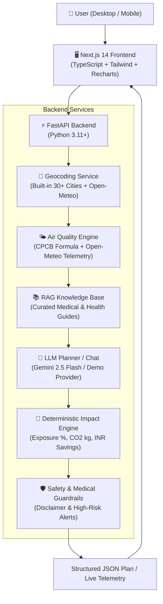

# 🌿 BreatheWise

### Your GenAI Companion for Cleaner Air and Smarter Days

*Cleaner air begins with smarter daily choices.*

[](https://open-meteo.com/)
[](https://ai.google.dev/)
[-009688?style=for-the-badge)](https://fastapi.tiangolo.com/)
[](https://nextjs.org/)
[](LICENSE)

---

## 📌 Contents

- [Overview](#-overview)
- [Key Features](#-key-features)
- [How It Works](#-how-it-works)
- [Project Architecture](#-project-architecture)
- [Repository Structure](#-repository-structure)
- [Quick Start](#-quick-start)
  - [1. One-Click Launch (Windows)](#1-one-click-launch-windows)
  - [2. Manual Terminal Setup](#2-manual-terminal-setup)
  - [3. Docker Compose](#3-docker-compose)
- [API Reference](#-api-reference)
- [How Impact Is Calculated](#-how-impact-is-calculated)
- [Testing](#-testing)
- [Responsible AI & Safety Safeguards](#-responsible-ai--safety-safeguards)
- [License](#-license)

---

## 🌍 Overview

Air pollution is not just an abstract number on a weather widget. It dictates whether a child with asthma can safely attend outdoor recess, whether an elderly family member should walk at 7:00 AM or 2:00 PM, and whether opening your windows ventilates or toxic-smogs your home.

**BreatheWise** transforms live environmental telemetry into **personalized, high-impact daily action plans**. Whether you are a family in Delhi navigating winter inversion smog, a college student in Guntur, or a housing society in Bengaluru, BreatheWise provides:
1. **Actionable Decisions**: Clear guidance on *when* to step outside and *what* to change at home.
2. **Household-Aware Personalization**: Tailored specifically for children, seniors, asthma patients, and commuters.
3. **Quantified Proof of Impact**: Transparent before-vs-after calculations showing exposure avoided, CO₂ eliminated, and money saved.

---

## ✨ Key Features

### 1. 🧠 Grounded GenAI Assistant & Planner
- Natural language Q&A in **English**, **हिन्दी (Hindi)**, **తెలుగు (Telugu)**, and **தமிழ் (Tamil)**.
- **RAG-Grounded**: Grounded in curated environmental health guidance (`indoor_air_quality.md`, `exercise_and_aqi.md`, `vulnerable_groups.md`, `masks_and_ppe.md`, `sustainable_transport.md`, `school_and_community.md`).
- Every recommendation includes a plain-language **Why**, verified sources, and an estimated impact.

### 2. ⚡ Instant City Search & Autocomplete
- **Pre-calibrated telemetry for 30+ major Indian cities**: Delhi, Guntur, Bengaluru, Mumbai, Kolkata, Hyderabad, Chennai, Pune, Ahmedabad, Jaipur, Lucknow, Patna, Vijayawada, Visakhapatnam, Chandigarh, Indore, Bhopal, Surat, Kochi, Coimbatore, Varanasi, and more.
- **Interactive search bar**: Real-time autocomplete suggestions with live color-coded AQI badges.
- **Dynamic procedural generator**: Instantly synthesizes realistic CPCB-aligned metrics for *any* searched Indian town or city.

### 3. 📊 Live CPCB AQI Dial & Diurnal Inversion Forecast
- **Six Segmented CPCB Bands with Value Marker Pin**: Active band highlighting with exact floating marker pin and band thresholds below:
  - **Good** (0–50) • **Satisfactory** (51–100) • **Moderate** (101–200) • **Poor** (201–300) • **Very Poor** (301–400) • **Severe** (401–500).
- **PM2.5 International & National Benchmarks**: Direct comparison against both the **WHO 2021 Guideline** (15 µg/m³) and **Indian NAAQS Standard** (60 µg/m³).
- **Realistic Diurnal Curve & Strictly Even 2-Hour Intervals**: 24-hour hourly CPCB AQI forecast at strictly even 2-hour increments (`00:00, 02:00, 04:00, 06:00, 08:00, 10:00, 12:00, 14:00, 16:00, 18:00, 20:00, 22:00`) reflecting natural atmospheric dynamics: morning peak (07:00–09:00), afternoon dispersion dip (14:00–16:00), and evening peak (20:00–22:00). Current 11:00 anchor is displayed via badged indicators and reference lines rather than breaking tick parity.
- **Dynamic Auto-Scaling**: The chart auto-scales the Y-axis to the data range rather than an arbitrary 0–500 scale.
- **Forecast-Based Safe Windows**: Optimal outdoor activity windows derived mathematically from the diurnal dip, with explanatory thermal mixing rationales.

### 4. 🏠 Household Profiling Engine
- Customizable family configuration:
  - **Members**: Children, adults, seniors, and individual respiratory sensitivities (asthma, allergies, COPD).
  - **Asthma Chips & Synchronized Counts**: Clear visual sensitivity chips rendered specifically on affected members; sensitivity counts are perfectly aligned across the dashboard and action plan pages.
  - **Transport**: Petrol, diesel, electric vehicles, two-wheelers, public transit, and commute distance.
  - **Home**: Apartment vs independent house, floor level, purifier status, and cooking fuel (LPG, induction, biomass).
  - **Work**: Work-from-home schedule.

### 5. 🧮 Deterministic Impact Engine
- Transparent formulas calculate:
  - **Exposure Reduction %**: Based on activity intensity and home infiltration factors.
  - **CO₂ Avoided (kg/week)**: Based on transport mode switches and trip consolidation (`emission_factors.json`).
  - **Cost Saved (₹/month)**: Fuel and public transit savings.
  - **Cigarette Equivalents Avoided**: General awareness equivalence (~22 µg/m³ PM2.5 over 24h ≈ 1 cigarette).

### 6. 🏫 School Protocol & 👥 Community Challenge Modes
- **School View**: Operational protocols for morning assemblies, outdoor physical education, playground recess, classroom ventilation, and asthmatic student safeguards.
- **Community View**: Neighborhood leaderboards (Indiranagar, Vasant Kunj, Bandra, etc.), car-free day challenges with toast feedback, and cumulative CO₂ reduction metrics tagged with "Demo Data" labels for full transparency.
- **Data Source Indicator**: Status badge visibly marks whether metrics are sourced from **Live API** or **Estimated** simulation.

---

## 🏗️ Project Architecture



---

## 📁 Repository Structure

```
air-pollution/
├── backend/
│   ├── app/
│   │   ├── main.py                  # FastAPI application entrypoint
│   │   ├── config.py                # App configuration & environment settings
│   │   ├── routers/
│   │   │   ├── aqi.py               # GET  /api/aqi (Live AQI, forecast, safe windows)
│   │   │   ├── plan.py              # POST /api/plan (Personalized daily action plan)
│   │   │   ├── chat.py              # POST /api/chat (RAG-grounded conversational agent)
│   │   │   ├── impact.py            # GET  /api/impact/summary (Savings & metrics)
│   │   │   ├── school.py            # GET  /api/school/guidance (Campus protocols)
│   │   │   └── community.py         # GET  /api/community/* (Leaderboards & challenges)
│   │   ├── services/
│   │   │   ├── air_quality.py       # CPCB calculations, Open-Meteo client & cache
│   │   │   ├── geocoding.py         # 30+ offline Indian cities + geocoding API
│   │   │   ├── impact.py            # Mathematical impact calculator
│   │   │   ├── rag.py               # Document indexing & TF-IDF/vector retrieval
│   │   │   ├── safety.py            # Disclaimer validation & medical guardrails
│   │   │   └── llm/                 # Gemini, OpenAI-compatible, & Demo providers
│   │   ├── models/schemas.py        # Pydantic data schemas
│   │   └── knowledge_base/          # Curated environmental health Markdown guides
│   ├── config/                      # emission_factors.json, exposure_assumptions.json
│   ├── demo_data/                   # Cached Delhi & Guntur telemetry for offline mode
│   ├── tests/                       # Pytest test suite (100% pass)
│   └── requirements.txt             # Python backend dependencies
├── frontend/
│   ├── src/
│   │   ├── app/
│   │   │   ├── layout.tsx           # Root layout & font configurations
│   │   │   ├── page.tsx             # Interactive dashboard, search bar, & views
│   │   │   └── globals.css          # Tailwind CSS directives
│   │   ├── components/
│   │   │   ├── RiskMeter.tsx        # 6-segment CPCB gauge & WHO/NAAQS metric cards
│   │   │   ├── SafeWindows.tsx      # Diurnal safe window recommendation cards
│   │   │   ├── ForecastChart.tsx    # Client-rendered 24-hr CPCB AQI diurnal chart
│   │   │   ├── PlanCard.tsx         # Daily personalized action checklists
│   │   │   ├── ImpactBar.tsx        # Before vs. After exposure & savings bar
│   │   │   ├── ChatAssistant.tsx    # Conversational GenAI assistant interface
│   │   │   ├── HouseholdSelector.tsx# Profile configuration drawer & sensitivity chips
│   │   │   ├── SchoolView.tsx       # Campus air quality advisory dashboard
│   │   │   └── CommunityView.tsx    # Neighborhood leaderboards & challenges
│   │   ├── lib/
│   │   │   ├── api.ts               # Typed client functions with timeout abort controller
│   │   │   ├── initialData.ts       # 30+ city presets & procedural fallback
│   │   │   └── i18n.ts              # English, Hindi, Telugu, Tamil translations
│   │   └── __tests__/               # Vitest frontend test suite
│   ├── package.json                 # Next.js dependencies
│   └── tailwind.config.js           # Tailwind styling configuration
├── main.py                          # Root backend launcher with sys.path resolution
├── run_all.bat                      # Unified one-click Windows launcher (starts both + opens browser)
├── run_backend.bat                  # Dedicated Windows backend launcher (FastAPI)
├── run_frontend.bat                 # Dedicated Windows frontend launcher (Next.js)
├── docker-compose.yml               # Multi-container Docker deployment
└── README.md                        # Project documentation
```

---

## ⚡ Quick Start

### 1. One-Click Launch (Windows)
The repository includes dedicated batch scripts for Windows:
1. Double-click **`run_all.bat`** to start both the FastAPI backend and Next.js frontend simultaneously and automatically open **[http://localhost:3000](http://localhost:3000)** in your browser.
2. Alternatively, you can run them individually:
   - Double-click **`run_backend.bat`** to start the FastAPI server on `http://127.0.0.1:8000`.
   - Double-click **`run_frontend.bat`** to start the Next.js web application on `http://localhost:3000`.

---

### 2. Manual Terminal Setup

#### Backend Setup
```bash
# 1. Navigate to backend
cd backend

# 2. Create virtual environment & activate
python -m venv .venv
# Windows:
.\.venv\Scripts\activate
# Linux/macOS:
source .venv/bin/activate

# 3. Install dependencies
pip install -r requirements.txt

# 4. (Optional) Configure environment
# Copy .env.example to .env and set DEMO_MODE=true or add GEMINI_API_KEY
copy .env.example .env

# 5. Start backend server
python -m uvicorn app.main:app --reload --port 8000
```
*API interactive documentation will be available at: [http://localhost:8000/docs](http://localhost:8000/docs)*

#### Frontend Setup
```bash
# 1. Open a new terminal and navigate to frontend
cd frontend

# 2. Install Node dependencies
npm install

# 3. Launch development server
npm run dev
```
*Web dashboard will be available at: [http://localhost:3000](http://localhost:3000)*

---

### 3. Docker Compose
To deploy both backend and frontend in isolated containers:
```bash
docker compose up --build
```

---

### 4. 🚀 GitHub Push & Vercel Deployment

#### Step 1: Push Code to GitHub
1. Create a new empty repository on [GitHub](https://github.com/new) (e.g. `breathewise`).
2. Run **`push_to_github.bat`** (or execute in terminal if Git is installed):
   ```bash
   git init
   git add .
   git commit -m "feat: complete BreatheWise urban air quality companion"
   git branch -M main
   git remote add origin https://github.com/<your-username>/breathewise.git
   git push -u origin main
   ```
   *(Ensure [Git for Windows](https://git-scm.com/download/win) or [GitHub Desktop](https://desktop.github.com/) is installed).*

#### Step 2: Deploy to Vercel

##### Option A: Deploy via Vercel Web Dashboard (Recommended)
1. Go to [vercel.com/new](https://vercel.com/new) and import your `breathewise` GitHub repository.
2. In the **Configure Project** screen:
   - Click **Edit** next to **Root Directory** and select **`frontend`**.
   - Framework Preset will automatically detect **Next.js**.
3. *(Optional)* Under **Environment Variables**, add `NEXT_PUBLIC_API_URL` pointing to your hosted FastAPI backend (e.g. Render / Railway). If omitted, BreatheWise operates with complete offline telemetry for 30+ Indian cities and procedural simulation.
4. Click **Deploy**. Your live production app will be live at `https://your-project.vercel.app`!

##### Option B: One-Click Deploy via Vercel CLI
1. Double-click **`deploy_vercel.bat`** in the project root, or run:
   ```bash
   cd frontend
   npx vercel
   ```
2. Log in with your browser when prompted and confirm default options. To deploy directly to production, run:
   ```bash
   npx vercel --prod
   ```

---

## 📡 API Reference

| Method | Endpoint | Description |
|:---:|---|---|
| **GET** | `/api/aqi?city={cityName}` | Returns current CPCB AQI, pollutant breakdown (PM2.5, PM10, NO₂, SO₂, CO, O₃), 24-hr hourly forecast, and safe windows. |
| **POST** | `/api/plan` | Generates a 3-section personalized daily action plan with before-vs-after impact calculations grounded in household demographics. |
| **POST** | `/api/chat` | RAG-grounded conversational assistant that answers queries with citations and safety disclaimers. |
| **GET** | `/api/impact/summary` | Returns aggregated environmental and cost savings statistics. |
| **GET** | `/api/school/guidance?city={cityName}` | Returns campus-specific advisory for assemblies, PE, recess, and asthmatic students. |
| **GET** | `/api/community/leaderboard` | Returns neighborhood leaderboard rankings and active community challenges. |

---

## 🧮 How Impact & AQI Are Calculated

### 1. Official CPCB NAQI Multi-Pollutant Calculation
In accordance with Central Pollution Control Board (CPCB) standards, NAQI is evaluated as the maximum sub-index across all monitored pollutants:
$$I_{\text{AQI}} = \max\left(I_{\text{PM2.5}},\, I_{\text{PM10}},\, I_{\text{NO2}},\, I_{\text{SO2}},\, I_{\text{CO}},\, I_{\text{O3}}\right)$$

Each pollutant sub-index $I_p$ is calculated using linear piecewise interpolation:
$$I_p = I_{\text{lo}} + \frac{I_{\text{hi}} - I_{\text{lo}}}{B_{\text{hi}} - B_{\text{lo}}} \times (C_p - B_{\text{lo}})$$

- **PM2.5 Breakpoints**:
  - $0\text{–}30 \rightarrow 0\text{–}50$ (Good)
  - $31\text{–}60 \rightarrow 51\text{–}100$ (Satisfactory)
  - $61\text{–}90 \rightarrow 101\text{–}200$ (Moderate) — *Evaluates $C_p = 60.1\ \mu\text{g/m}^3$ at official lower bound 61 to yield $I_{\text{PM2.5}} \approx 98$*
  - $91\text{–}120 \rightarrow 201\text{–}300$ (Poor)
  - $121\text{–}250 \rightarrow 301\text{–}400$ (Very Poor)
  - $250+ \rightarrow 401\text{–}500$ (Severe)
- **PM10 Breakpoints**:
  - $0\text{–}50 \rightarrow 0\text{–}50$ (Good)
  - $51\text{–}100 \rightarrow 51\text{–}100$ (Satisfactory)
  - $101\text{–}250 \rightarrow 101\text{–}200$ (Moderate) — *Evaluates $C_p = 118.3\ \mu\text{g/m}^3$ to yield $I_{\text{PM10}} = 113$*
  - $251\text{–}350 \rightarrow 201\text{–}300$ (Poor)
  - $351\text{–}430 \rightarrow 301\text{–}400$ (Very Poor)
  - $430+ \rightarrow 401\text{–}500$ (Severe)
- **Overall CPCB AQI**: At $C_{\text{PM2.5}} = 60.1$ and $C_{\text{PM10}} = 118.3$, $I_{\text{AQI}} = \max(98, 113) = \mathbf{113\ (\text{Moderate})}$.

---

### 2. Deterministic Impact Engine

To ensure complete transparency and eliminate arbitrary AI hallucination, all numerical savings are generated by a deterministic mathematical engine:

| Metric | Formula |
|---|---|
| **Exposure Avoided** | $$\sum (\text{PM2.5}_{\text{before}} - \text{PM2.5}_{\text{after}}) \times \text{hours} \times \text{activity\_factor}$$ *(where indoor particulate accounts for closed windows and filtration efficiency)* |
| **CO₂ Avoided** | $$\text{distance}_{\text{km}} \times (\text{EF}_{\text{current}} - \text{EF}_{\text{new}})$$ *(using emission factors from `emission_factors.json`)* |
| **Cost Saved** | $$\text{distance}_{\text{km}} \times (\text{cost\_per\_km}_{\text{current}} - \text{cost\_per\_km}_{\text{new}})$$ |
| **Cigarette Equivalence** | $$\approx 22\ \mu\text{g/m}^3\ \text{PM2.5 over 24 hours} \approx 1\ \text{cigarette/day}$$ *(awareness reference)* |

---

## 🧪 Testing

The codebase includes automated test suites for both backend logic and frontend localization:

```bash
# Run backend tests (Pytest)
cd backend
pytest -v

# Run frontend tests (Vitest)
cd frontend
npm test -- --run
```

---

## 🛡️ Responsible AI & Safety Safeguards

1. **Environmental Health Support, Not Medical Advice**: BreatheWise is a decision-support platform, not a medical diagnosis device. All interfaces prominently present non-medical disclaimers.
2. **Automated Vulnerability Safeguards**: If a household profile indicates asthma or respiratory sensitivities, or if ambient AQI exceeds Poor (200+), high-priority caution banners are automatically attached to the action plan.
3. **No Hallucinated Figures**: The GenAI assistant explains and communicates guidance; all impact numbers, percentages, and currencies are computed deterministically by verified mathematical code.

---

## 📄 License

This project is licensed under the **MIT License**.
