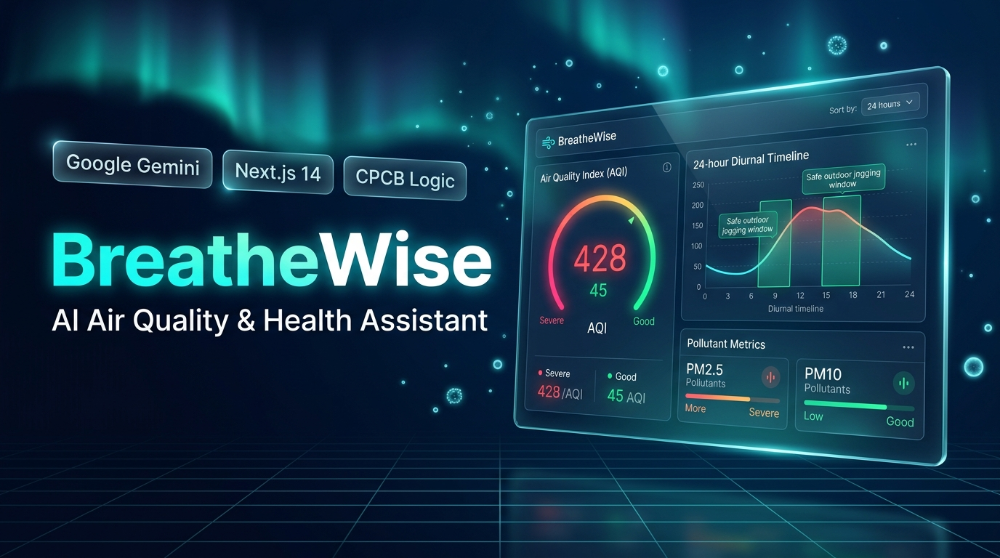
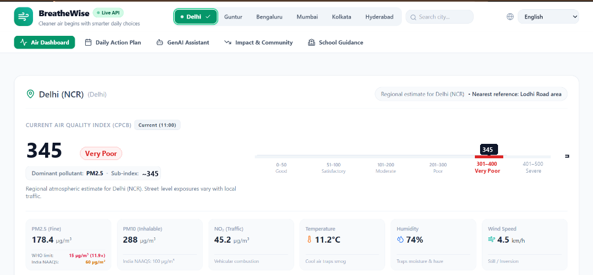
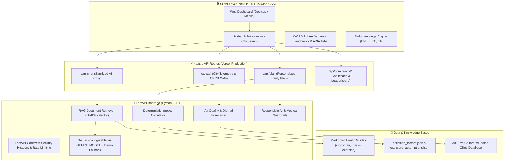

# 🌿 BreatheWise — Urban Air Quality Assistant

### PromptWars Virtual Hackathon — [Challenge 6] Urban Air Quality Assistant

> **"Create a GenAI-powered assistant that helps families and communities navigate severe winter smog and urban air pollution. The application should suggest low-emission daily routines, indoor air quality hacks, and sustainable alternatives tailored to their location and lifestyle, while clearly explaining the direct impact of their choices."**



[](https://github.com/kushal3698/BreatheWise-Air-Quality-Assistance/actions/workflows/ci.yml)
[](https://breathewise-air-quality-assistance.vercel.app/)
[](backend/tests)
[](frontend/src/__tests__/a11y.test.ts)
[](SECURITY.md)

---

### ⚡ Quick Requirement Mapping
- **Low-Emission Routines** $\rightarrow$ Daily Action Plan Card 1 (`PlanCard.tsx`) & Diurnal Forecast (`SafeWindows.tsx`).
- **Indoor Air Quality Hacks** $\rightarrow$ Daily Action Plan Card 2 (`PlanCard.tsx`) & RAG Knowledge Base (`indoor_air_quality.md`).
- **Sustainable Alternatives** $\rightarrow$ Household Drawer (`HouseholdSelector.tsx`) & Transit Whitelist (`initialData.ts`).
- **Direct Impact Explained** $\rightarrow$ Quantified Impact Engine (`ImpactBar.tsx`) with transparent "Why this matters" rationales.

---

## 📌 Contents

- [🎯 Challenge 6 Requirement Traceability Matrix](#-challenge-6-requirement-traceability-matrix)
- [🌍 Overview & Problem Statement](#-overview--problem-statement)
- [❄️ Winter Smog Playbook](#️-winter-smog-playbook)
- [📸 Application Screenshots](#-application-screenshots)
- [✨ Key Features](#-key-features)
- [🏗️ System Architecture](#️-system-architecture)
- [📁 Repository Structure](#-repository-structure)
- [⚡ Quick Start & Deployment](#-quick-start--deployment)
- [📡 API Reference](#-api-reference)
- [📄 Sample API Plan Response](#-sample-api-plan-response)
- [⚙️ Environment Variables & Config](#️-environment-variables--config)
- [🧮 Mathematical Engine & CPCB Breakpoints](#-mathematical-engine--cpcb-breakpoints)
- [📡 Data Sources & Limitations](#-data-sources--limitations)
- [🧪 Automated Testing & CI/CD](#-automated-testing--cicd)
- [♿ Accessibility (WCAG 2.1 AA)](#-accessibility-wcag-21-aa)
- [🔒 Security & Threat Modeling](#-security--threat-modeling)
- [🛡️ Responsible AI & Medical Safeguards](#️-responsible-ai--medical-safeguards)
- [📄 License](#-license)

---

## 🎯 Challenge 6 Requirement Traceability Matrix

Each clause of the official Challenge 6 brief is mapped to the code that implements it:

| Challenge 6 Requirement | Implementation Module | Source File(s) | Verification & Evidence |
|:---|:---|:---|:---|
| **GenAI-Powered Assistant** | Multi-lingual RAG-grounded conversational agent with document citations and localized context | `frontend/src/components/ChatAssistant.tsx`<br>`backend/app/routers/chat.py`<br>`backend/app/services/llm/` | Natural conversational interface in **English, Hindi, Telugu, and Tamil**. Answers user queries with domain grounding (`indoor_air_quality.md`, `vulnerable_groups.md`) and non-medical disclaimers. Live demo is rule-based; Gemini is used when a key is set. |
| **Helps Families Navigate Winter Smog** | Household Profiling Engine with sensitive-member tracking & tailored cautions | `frontend/src/components/HouseholdSelector.tsx`<br>`backend/app/services/safety.py`<br>`backend/app/models/schemas.py` | Configurable family profiles: track children, seniors, and respiratory sensitivities (asthma, COPD). Two caution triggers: (1) an inhaler caution is always shown when a household member has asthma/COPD, regardless of AQI; (2) a general air-quality caution is added when AQI reaches an unhealthy category (Poor or worse). |
| **Helps Communities Navigate Smog** | School Guidance Protocols & Neighborhood Community Challenges with real-time feedback | `frontend/src/components/SchoolView.tsx`<br>`frontend/src/components/CommunityView.tsx`<br>`backend/app/routers/school.py`<br>`backend/app/routers/community.py` | Operational protocols for morning assembly, sports PE, and recess ventilation. Neighborhood leaderboards with car-free challenges and cumulative community CO₂ counters. |
| **Suggests Low-Emission Daily Routines** | Dynamic Daily Action Planner with diurnal curve synchronization | `frontend/src/components/PlanCard.tsx`<br>`backend/app/routers/plan.py`<br>`backend/app/services/air_quality.py` | Recommends optimal exercise windows (shifting from morning inversion to afternoon thermal mixing), work-from-home coordination, and trip consolidation. |
| **Indoor Air Quality Hacks** | Actionable, zero-cost and low-cost indoor mitigation techniques | `frontend/src/components/PlanCard.tsx`<br>`backend/app/knowledge_base/indoor_air_quality.md` | Wet mopping over sweeping, DIY Corsi-Rosenthal filtration boxes, window sealing during smog peaks, timed ventilation during afternoon dips, and kitchen exhaust protocols. |
| **Sustainable Alternatives Tailored to Location & Lifestyle** | Location-aware multi-modal transit and lifestyle alternatives | `frontend/src/components/HouseholdSelector.tsx`<br>`frontend/src/lib/initialData.ts`<br>`backend/app/services/geocoding.py` | Metro-aware transit switches: recommends **bus/metro** in metro cities, and **public bus/shared electric shuttles** in non-metro cities (e.g. Guntur, Vijayawada). Tailored to vehicle fuel type, floor level, and cooking fuel. |
| **Clearly Explaining Direct Impact of Choices** | Deterministic Mathematical Impact Engine with Before-vs-After comparison | `frontend/src/components/ImpactBar.tsx`<br>`backend/app/services/impact.py`<br>`backend/config/emission_factors.json` | Quantified numerical cards: **Exposure Avoided %**, **CO₂ Avoided (kg/week)**, **Cost Saved (₹/month)**, and **Cigarette Equivalents Avoided** (~22 µg/m³ PM2.5 / 24h ≈ 1 cigarette). |

---

## 🌍 Overview & Problem Statement

Urban air pollution across Indian cities—especially during severe winter temperature inversions—poses acute health hazards. However, conventional air quality dashboards only present static numbers without contextualizing what families should actually do.

**BreatheWise** is an intelligent, GenAI-powered urban companion that transforms real-time and modelled environmental telemetry into actionable, daily lifestyle decisions:
1. **Decision Support**: Clear answers to *"When should I exercise?"*, *"Can my child play outside today?"*, and *"How do I keep indoor air clean?"*
2. **Demographic Tailoring**: Automatically adapts recommendations based on family members (children, seniors, asthmatic individuals) and living situations (apartment floor, cooking fuel).
3. **Transparent Mathematical Proof**: Quantifies the environmental and economic impact of each choice with deterministic calculations.

---

## ❄️ Winter Smog Playbook

The brief asks for help during **severe winter smog**. BreatheWise treats winter as a specific, time-of-day problem and maps each cause to a feature.

### Why winter air is worse
- **Temperature inversion:** Cold ground-level air is trapped under a warmer layer, so pollutants stay near the surface, especially from night until late morning.
- **Low wind and fog:** Calm, humid mornings keep particulates suspended.
- **Extra sources in the cold season:** Open burning of leaves, waste and crop residue (mainly in north India), biomass heating and cooking, and festival emissions.
- **Regional variation:** Inversion and burning episodes are most severe in the Indo-Gangetic Plain (e.g. Delhi, Lucknow, Patna). BreatheWise tailors advice dynamically to local forecast telemetry across all Indian cities, rather than assuming a uniform seasonal baseline.

### How each cause maps to a feature
| Winter problem | BreatheWise response | Where |
|:---|:---|:---|
| Morning inversion peak | Diurnal curve shows the morning peak; plan advises keeping intense cardio indoors until air improves | `ForecastChart.tsx`, `PlanCard.tsx` |
| Cleaner afternoon window | Safe Windows derived from the afternoon thermal-mixing dip | `SafeWindows.tsx` |
| Polluted air getting indoors | Seal windows at the morning peak, ventilate in the safe window, run a HEPA purifier or DIY Corsi-Rosenthal box | Indoor Air Playbook |
| Open burning | Zero Open-Burning Vigilance community challenge | `CommunityView.tsx` |
| Vulnerable people | Asthma caution banner for sensitive members; school protocols for assembly, PE and recess | `safety.py`, `SchoolView.tsx` |

### Honest note on the forecast
The 24-hour curve is a **modelled diurnal shape** anchored to the current estimate, not a measured hourly station feed. See [Data Sources & Limitations](#-data-sources--limitations).

---

## 📸 Application Screenshots

| Live Air Dashboard (CPCB NAQI 345 Very Poor) | Dynamic Daily Action Plan (Tailored Mitigations) |
|:---:|:---:|
|  |  |
| *Real-time CPCB NAQI calculation with dominant pollutant PM2.5 (345), WHO exceedance benchmarks, and meteorological telemetry.* | *Personalized winter smog mitigation plan with diurnal safe window, asthma alerts, structured action cards, and quantified impact.* |

---

## ✨ Key Features

### 1. 📊 Official CPCB NAQI Dial & Diurnal Forecast
- **CPCB-Standard Formula**: Headline AQI computed as the strict maximum across pollutant sub-indices ($\max(I_{\text{PM2.5}}, I_{\text{PM10}}, I_{\text{NO2}}, \dots)$).
- **Synchronized Visual Feedback**: A single source of truth (`getAQIBand`) simultaneously controls the category badge, color accent, and active segment highlight on the 6-band CPCB gauge (**Good**, **Satisfactory**, **Moderate**, **Poor**, **Very Poor**, **Severe**).
- **Dominant Pollutant Callout**: Instantly surfaces the primary health driver (e.g. `Dominant pollutant: PM2.5 • Sub-index: ~345`).
- **Benchmark Indicators**: Displays both **India NAAQS** and **WHO 2021** reference thresholds with real-time exceedance multipliers.
- **Realistic Diurnal Inversion Curve**: 24-hour forecast sampled at strictly even 2-hour increments (`00:00, 02:00, ..., 22:00`) illustrating natural atmospheric physics: morning inversion peak (08:00), afternoon thermal dispersion dip (14:00), and evening traffic peak (20:00).
- **Mathematically Derived Safe Windows**: Highlights optimal outdoor exposure windows matching the afternoon thermal mixing dip.

### 2. 🧠 GenAI Assistant & RAG Knowledge Base
- **Multi-Lingual NLP**: Full conversational support in **English**, **हिन्दी (Hindi)**, **తెలుగు (Telugu)**, and **தமிழ் (Tamil)**.
- **RAG-Grounded**: Responses retrieve facts from verified environmental health guides (`indoor_air_quality.md`, `exercise_and_aqi.md`, `vulnerable_groups.md`, `masks_and_ppe.md`, `sustainable_transport.md`, `school_and_community.md`).
- **Explainable Reasoning**: Every recommendation includes a plain-language **Why**, verified sources, and confidence classification.

### 3. 🏠 Household Personalization Drawer
- **Vulnerable Group Tagging**: Add household members with specific respiratory sensitivities (asthma, COPD).
- **Synchronized Sensitivity Badges**: Visual chips persist across dashboard and plan views.
- **Lifestyle & Housing Config**: Set transport modes (petrol car, diesel, EV, two-wheeler), commute distances, floor level, air purifier status, and cooking fuel.

### 4. 🧮 Deterministic Impact Engine
- **No Hallucinated Statistics**: All environmental and financial savings are calculated using deterministic formulas from official emission factors (`backend/config/emission_factors.json`):
  - **Exposure Reduction %**: Indoor filtration and activity shifting.
  - **CO₂ Avoided (kg/week)**: Multi-modal transport replacement.
  - **Fuel Cost Saved (₹/month)**: Commute fuel vs. public transit tariffs.
  - **Cigarette Equivalents Avoided**: Public health awareness metric ($\approx 22\ \mu\text{g/m}^3\ \text{PM2.5 over 24h} \approx 1\ \text{cigarette}$).

### 5. 👥 Community Challenges & 🏫 School Advisory Protocols
- **School Guidance Dashboard**: Automatic threshold-based operational advisories for school administrators (morning assemblies, PE, playground recess, classroom ventilation, and asthmatic student safeguards).
- **Community Challenges**: Car-free days, cycling commutes, and DIY filtration challenges with instant feedback toasts and neighborhood leaderboards.

---

## 🏗️ System Architecture



> **Live Deployment Note:** On the live Vercel deployment, `/api/chat`, `/api/aqi`, and `/api/plan` run via lightweight Next.js serverless functions with complete offline pre-calibrated telemetry and grounded rule-based responses (proxying to Gemini when `GEMINI_API_KEY` is provided, configurable via `GEMINI_MODEL`). If the model call fails, the assistant falls back to the rule-based provider. The standalone FastAPI service powers local Python development and containerized Docker setups.

---

## 📁 Repository Structure

```
BreatheWise-Air-Quality-Assistance/
├── .github/
│   └── workflows/
│       └── ci.yml                   # Automated GitHub Actions CI (Frontend & Backend)
├── backend/
│   ├── app/
│   │   ├── main.py                  # FastAPI app with HTTP security headers & rate limiting
│   │   ├── config.py                # Pydantic BaseSettings, named constants & CORS origins
│   │   ├── routers/
│   │   │   ├── aqi.py               # GET  /api/aqi (CPCB telemetry & forecast)
│   │   │   ├── plan.py              # POST /api/plan (Household daily action plan)
│   │   │   ├── chat.py              # POST /api/chat (RAG conversational agent)
│   │   │   ├── impact.py            # GET  /api/impact/summary (Deterministic metrics)
│   │   │   ├── school.py            # GET  /api/school/guidance (Campus protocols)
│   │   │   └── community.py         # GET  /api/community/* (Leaderboard & challenges)
│   │   ├── services/
│   │   │   ├── air_quality.py       # CPCB NAQI math, Open-Meteo client, diurnal forecast
│   │   │   ├── geocoding.py         # 30+ pre-calibrated Indian cities & geocoding
│   │   │   ├── impact.py            # Mathematical exposure, CO2, and INR calculator
│   │   │   ├── rag.py               # Knowledge base retrieval & document indexing
│   │   │   ├── safety.py            # Medical disclaimer & asthma safety rules
│   │   │   └── llm/                 # Gemini (configurable via GEMINI_MODEL) & Demo providers
│   │   ├── models/schemas.py        # Pydantic validation models with input limits
│   │   └── knowledge_base/          # Curated evidence-based environmental health guides
│   ├── config/                      # emission_factors.json, exposure_assumptions.json
│   ├── tests/                       # Pytest test suite (29 tests passing)
│   └── requirements.txt             # Python dependencies
├── frontend/
│   ├── src/
│   │   ├── app/
│   │   │   ├── layout.tsx           # Root HTML layout with skip-to-content anchor
│   │   │   ├── page.tsx             # Modular dashboard with ARIA tablist
│   │   │   ├── globals.css          # Tailwind directives
│   │   │   └── api/                 # Next.js Serverless API routes (aqi, chat, plan, community)
│   │   ├── components/
│   │   │   ├── Navbar.tsx           # Extracted sticky top navigation & instant search
│   │   │   ├── Footer.tsx           # Extracted accessible disclaimer footer
│   │   │   ├── RiskMeter.tsx        # 6-band CPCB gauge with synchronized marker & getAQIBand
│   │   │   ├── SafeWindows.tsx      # Diurnal safe window cards with thermal mixing rationale
│   │   │   ├── ForecastChart.tsx    # 24-hr CPCB AQI diurnal chart with 2h tick intervals
│   │   │   ├── PlanCard.tsx         # 3-section daily action plan
│   │   │   ├── ImpactBar.tsx        # Before vs. After exposure & savings bar
│   │   │   ├── ChatAssistant.tsx    # Conversational GenAI assistant
│   │   │   ├── HouseholdSelector.tsx# Profile drawer & sensitivity chips
│   │   │   ├── SchoolView.tsx       # Campus advisory protocol dashboard
│   │   │   └── CommunityView.tsx    # Responsive neighborhood leaderboard & challenges
│   │   ├── lib/
│   │   │   ├── api.ts               # Resilient client API functions
│   │   │   ├── initialData.ts       # 30+ city presets & CPCB NAQI calculations
│   │   │   └── i18n.ts              # English, Hindi, Telugu, Tamil translations
│   │   └── __tests__/               # Vitest suite: app, a11y, cpcbBreakpoints, i18n (24 tests)
│   ├── next.config.js               # Strict HTTP security headers (HSTS, CSP, X-Frame)
│   ├── package.json                 # Next.js 14 & dependencies
│   └── tailwind.config.js           # Tailwind CSS configuration
├── docs/assets/
│   └── thumbnail.jpg                # 16:9 Presentation thumbnail
├── run_all.bat                      # Unified Windows launcher
├── run_backend.bat                  # Dedicated FastAPI backend launcher
├── run_frontend.bat                 # Dedicated Next.js frontend launcher
├── .env.example                     # Environment template (zero committed secrets)
├── CONTRIBUTING.md                  # Code style, testing, and contribution guide
├── SECURITY.md                      # Formal security policy & threat model
├── LICENSE                          # MIT License
└── README.md                        # Documentation & requirement matrix
```

---

## ⚡ Quick Start & Deployment

### 1. Unified Launch (Windows)
```powershell
# Double-click or run from terminal:
.\run_all.bat
```
Starts both the FastAPI backend and Next.js frontend and opens `http://localhost:3000` in your browser.

### 2. Manual Terminal Setup

```bash
# 1. Initialize environment variables from template (once at repository root)
cp .env.example .env
```

#### Backend Setup
```bash
cd backend
python -m venv .venv
# Windows: .\.venv\Scripts\activate
# Linux/macOS: source .venv/bin/activate
pip install -r requirements.txt
python -m uvicorn app.main:app --reload --port 8000
```
*Interactive Swagger documentation: [http://localhost:8000/docs](http://localhost:8000/docs)*

#### Frontend Setup
```bash
cd frontend
npm install
npm run dev
```
*Application interface: [http://localhost:3000](http://localhost:3000)*

### 3. Vercel Production Deployment
The frontend is optimized for zero-configuration deployment to **Vercel**:
1. Connect the repository at [vercel.com](https://vercel.com).
2. Set **Root Directory** to `frontend`.
3. Framework preset will automatically configure **Next.js**.
4. Click **Deploy**. Complete telemetry operates immediately via serverless routes.

---

## 📡 API Reference

| Method | Endpoint | Description |
|:---:|---|---|
| **GET** | `/api/aqi?city={name}` | Returns official CPCB AQI, sub-indices, dominant pollutant, 24-hr diurnal forecast, and safe windows. |
| **POST** | `/api/plan` | Generates a 3-section personalized daily action plan with before-vs-after impact metrics grounded in household profile. |
| **POST** | `/api/chat` | RAG-grounded conversational agent with sanitized inputs and source citations. |
| **GET** | `/api/impact/summary` | Aggregated environmental and financial savings metrics. |
| **GET** | `/api/school/guidance?city={name}` | School operational protocols for assemblies, PE, recess, and asthmatic students. |
| **GET** | `/api/community/leaderboard` | Neighborhood leaderboards and active community challenges. |

---

## 📄 Sample API Plan Response

`POST /api/plan` returns a structured schema combining actionable routines with deterministic impact:

```json
{
  "summary": "Elevated Very Poor smog today in Delhi (NCR) (AQI 345). Ground inversion traps morning emissions; shift cardio indoors and use the afternoon safe window (13:30 – 16:30).",
  "risk_level": "high",
  "sections": {
    "low_emission_routines": [
      {
        "action": "Schedule outdoor exercise during the afternoon safe window (13:30 – 16:30)",
        "why": "Between 06:00 and 09:30 AM, AQI peaks near ~390 during ground inversion. Morning cardio increases fine particle alveolar intake.",
        "effort": "low",
        "cost": "free",
        "impact": { "exposure_reduction_pct": 55.0, "confidence": "Modelled estimate" },
        "sources": ["kb/exercise_and_aqi.md"]
      },
      {
        "action": "Shift peak commute (8–10 AM) to Metro or carpool",
        "why": "Avoids concentrated tailpipe exhaust in traffic congestion; switching from single-occupancy petrol car (170g CO2/km) to metro (14g CO2/km) cuts transit emissions by ~92% per commute kilometer.",
        "effort": "medium",
        "cost": "free",
        "impact": { "exposure_reduction_pct": 35.0, "co2_saved_kg": 2.3, "cost_saved_inr": 110.0, "confidence": "Modelled estimate" },
        "sources": ["kb/sustainable_transport.md"]
      }
    ],
    "indoor_air_hacks": [
      {
        "action": "Keep windows shut during morning peak; cross-ventilate during 13:30 – 16:30",
        "why": "Afternoon solar convection breaks the inversion layer, dropping PM2.5 to the daily low.",
        "effort": "low",
        "cost": "free",
        "impact": { "exposure_reduction_pct": 35.0, "confidence": "Modelled estimate" },
        "sources": ["kb/indoor_air_quality.md"]
      }
    ],
    "sustainable_alternatives": [
      {
        "action": "Batch grocery and errand trips across Delhi (NCR) during the safe window",
        "why": "Reduces cold-start engine emissions and lowers weekly fuel burn.",
        "effort": "low",
        "cost": "free",
        "impact": { "exposure_reduction_pct": 15.0, "co2_saved_kg": 1.2, "cost_saved_inr": 50.0, "confidence": "Modelled estimate" },
        "sources": ["kb/sustainable_transport.md"]
      }
    ]
  },
  "today_timeline": [
    { "time": "06:00 - 09:30", "advice": "Very Poor morning peak. Ground inversion traps traffic exhaust; keep all exercise indoors." },
    { "time": "13:30 – 16:30", "advice": "Optimal safe window today. Afternoon solar convection disperses surface pollutants." }
  ],
  "impact_summary": {
    "exposure_reduction_pct": 42.0,
    "co2_avoided_kg_week": 8.5,
    "cost_saved_inr_month": 1850.0,
    "cigarettes_avoided_day": 3.4,
    "confidence": "Modelled estimate"
  },
  "cautions": [
    "One or more household members have respiratory sensitivities (asthma/COPD): Keep prescribed fast-acting reliever inhalers within immediate reach."
  ],
  "disclaimer": "Estimates for awareness only. BreatheWise is a decision-support tool, not a medical device."
}
```

> **Units Note:** Action items reflect immediate single-event savings (₹110/commute, ₹50/errand), scaled to monthly totals in the overall impact summary.

---

## ⚙️ Environment Variables & Config

All environment variables have sensible defaults and fallback to complete offline operation:

| Variable | Default | Purpose |
|:---|:---|:---|
| `DEMO_MODE` | `true` | When true, serves pre-calibrated offline telemetry for 30+ Indian cities. |
| `DEFAULT_CITY` | `Delhi` | Fallback city on initial launch. |
| `LLM_PROVIDER` | `gemini` | `gemini` or `demo` (rule-based fallback). If the model call fails, the assistant falls back to the rule-based provider. |
| `GEMINI_API_KEY` | `""` | Optional Google AI Studio API key for conversational chat. |
| `GEMINI_MODEL` | `gemini-3.5-flash` | Configurable via `GEMINI_MODEL` (e.g. `gemini-3.5-flash`). |
| `CORS_ORIGINS` | `http://localhost:3000,http://127.0.0.1:3000` | Whitelisted cross-origin request sources. |
| `RATE_LIMIT_RPM` | `120` | Maximum requests permitted per minute per client IP. |

---

## 🧮 Mathematical Engine & CPCB Breakpoints

### Official CPCB NAQI Formulation
In strict compliance with Central Pollution Control Board (CPCB) standards, NAQI is evaluated as the maximum sub-index across all monitored pollutants:
$$I_{\text{AQI}} = \max\left(I_{\text{PM2.5}},\, I_{\text{PM10}},\, I_{\text{NO2}},\, I_{\text{SO2}},\, I_{\text{CO}},\, I_{\text{O3}}\right)$$

Each pollutant sub-index $I_p$ is calculated using linear piecewise interpolation:
$$I_p = I_{\text{lo}} + \frac{I_{\text{hi}} - I_{\text{lo}}}{B_{\text{hi}} - B_{\text{lo}}} \times (C_p - B_{\text{lo}})$$

#### CPCB Official Breakpoints:
- **$\text{PM}_{2.5}$**:
  - $0\text{–}30 \rightarrow 0\text{–}50$ (Good)
  - $31\text{–}60 \rightarrow 51\text{–}100$ (Satisfactory)
  - $61\text{–}90 \rightarrow 101\text{–}200$ (Moderate)
  - $91\text{–}120 \rightarrow 201\text{–}300$ (Poor)
  - $121\text{–}250 \rightarrow 301\text{–}400$ (Very Poor)
  - $250.1\text{–}380 \rightarrow 401\text{–}500$ (Severe; 380 is an interpolation cap, CPCB defines Severe as 250+)
- **$\text{PM}_{10}$**:
  - $0\text{–}50 \rightarrow 0\text{–}50$ (Good)
  - $51\text{–}100 \rightarrow 51\text{–}100$ (Satisfactory)
  - $101\text{–}250 \rightarrow 101\text{–}200$ (Moderate)
  - $251\text{–}350 \rightarrow 201\text{–}300$ (Poor)
  - $351\text{–}430 \rightarrow 301\text{–}400$ (Very Poor)
  - $430.1\text{–}600 \rightarrow 401\text{–}500$ (Severe; 600 is an interpolation cap, CPCB defines Severe as 430+)

#### Real-World Delhi Worked Example:
- **$\text{PM}_{2.5} = 178.4\ \mu\text{g/m}^3$**: Bin $[121, 250] \rightarrow [301, 400] \implies 301 + \frac{99}{129} \times (178.4 - 121) = \mathbf{345}$
- **$\text{PM}_{10} = 288.0\ \mu\text{g/m}^3$**: Bin $[251, 350] \rightarrow [201, 300] \implies 201 + \frac{99}{99} \times (288.0 - 251) = \mathbf{238}$
- **$\text{NO}_2 = 45.2\ \mu\text{g/m}^3$**: Bin $[41, 80] \rightarrow [51, 100] \implies 51 + \frac{49}{39} \times (45.2 - 41) = \mathbf{56}$
- **Final CPCB AQI**: $\max(345, 238, 56) = \mathbf{345\ (\text{Very Poor})}$ with **Dominant Pollutant: $\text{PM}_{2.5}$**.

---

## 📡 Data Sources & Limitations

### 1. Telemetry Transparency
- **Modelled Atmospheric Estimates**: Unless connected to an active CAAQMS physical station feed, telemetry is derived from atmospheric reanalysis models via Open-Meteo and procedural diurnal boundary layer modeling. The application prominently displays:
  > `● Modelled estimate • Regional estimate for {City} • Street level exposures vary with local traffic.`

### 2. CPCB Integer Rounding Protocol
Under official Indian Central Pollution Control Board reporting conventions, ambient sensor concentrations are evaluated against integer breakpoint bands:
- An observed $\text{PM}_{2.5}$ of $60.1\ \mu\text{g/m}^3$ rounds to $60\ \mu\text{g/m}^3$, which sits at the upper limit of the Satisfactory band ($31\text{–}60$), yielding an exact sub-index of **100**.
- An observed $\text{PM}_{10}$ of $118.3\ \mu\text{g/m}^3$ rounds to $118$ and falls in the Moderate bin $[101, 250] \rightarrow [101, 200]$, yielding a sub-index of **112**.
- The composite AQI is $\max(100, 112) = \mathbf{112\ (\text{Moderate})}$, with **Dominant Pollutant: $\text{PM}_{10}$**.

---

## 🧪 Automated Testing & CI/CD

BreatheWise maintains **53 automated tests** (29 backend, 24 frontend) integrated into GitHub Actions. Backend line coverage is about 72% (pytest-cov), with CI enforcing a 65% minimum, plus ruff, black and ESLint checks:

```bash
# Frontend Tests (Vitest — 24 passed)
cd frontend
npm test -- --run

# Backend Tests (Pytest with Coverage — 29 passed)
python -m pytest backend/tests -v
```

### GitHub Actions CI Workflow (`.github/workflows/ci.yml`)
- **`frontend-ci`**: Node 20 environment, dependency caching, Vitest execution, and production build verification.
- **`backend-ci`**: Python 3.11 environment, ruff and black checks, then Pytest with coverage across schemas, safety rules, LLM-provider fallbacks, and CPCB algorithms.
- **`security-audit`**: Automated secret scanning ensuring zero credentials exist in version control.

---

## ♿ Accessibility (WCAG 2.1 AA)

BreatheWise is designed for inclusive access:
- **Skip to Main Content**: Keyboard-accessible anchor (`#main-content`) allows screen reader and keyboard users to bypass navigation.
- **ARIA Semantics**: Proper `role="tablist"`, `role="tab"`, `aria-selected`, `role="status"`, `aria-live="polite"`, and `role="search"` attributes throughout.
- **Contrast Ratios**: Color palettes for all 6 CPCB bands are designed for WCAG 2.1 AA contrast standards with high-contrast text pairings.
- **Screen Reader Support**: Decorative icons feature `aria-hidden="true"`, while interactive inputs provide explicit `aria-label` tags.
- **Multi-Language Tagging**: Main content containers carry explicit `lang` attributes (`en`, `hi`, `te`, `ta`) so screen readers select correct voice engines.

---

## 🔒 Security & Threat Modeling

BreatheWise adheres to strict cybersecurity standards (see [SECURITY.md](SECURITY.md)):
- **HTTP Security Headers**: Enforces `Strict-Transport-Security`, `X-Frame-Options: DENY`, `X-Content-Type-Options: nosniff`, `X-XSS-Protection: 1; mode=block`, and restrictive `Permissions-Policy`.
- **In-Memory Rate Limiting**: Enforces a 120 requests/minute ceiling per client IP with `429 Too Many Requests` responses.
- **Multi-Lingual Input Sanitization**: City parameters are sanitized using a Unicode-aware regular expression with the `u` flag (`/[^\p{L}\p{M}\p{N}\s()\-.]/gu`), preserving Latin, Devanagari, Telugu, and Tamil characters while neutralizing cross-site scripting (XSS) and injection attempts. Chat queries are length-capped at 1,000 characters.
- **Stack Trace Suppression**: Generic 500 error handler prevents exposure of internal exception traces.
- **Zero Committed Secrets**: `.env.example` template provided; offline simulation operates seamlessly without requiring external credentials.

---

## 🛡️ Responsible AI & Medical Safeguards

1. **Non-Medical Disclaimer**: BreatheWise is a decision-support and awareness platform, not a medical diagnosis device. Disclaimers are prominently displayed.
2. **Asthma & Vulnerability Triggers**: Two caution triggers: (1) an inhaler caution is always shown when a household member has asthma/COPD, regardless of AQI; (2) a general air-quality caution is added when AQI reaches an unhealthy category (Poor or worse, i.e. above 200). These guardrails are applied after every provider (rule-based or LLM) so a model can never omit them, and impact figures always come from the deterministic engine, never from model output.
3. **Deterministic Math**: Impact figures are computed mathematically rather than generated by LLMs to eliminate numerical hallucinations.

---

## 📄 License

This project is licensed under the **MIT License** — see the [LICENSE](LICENSE) file for details.
